# FabricaTileGroup

Este é um conjunto de *Tiles* com a temática de fábrica para ser utilizado na construção de níveis para o RocoCo. 

```
import static br.dev.botecodigital.level.tiles.tilegroup.FabricaTiles.*;
```

## Piso

Var     | Image
--------| --------------------------------
BACK010 | 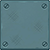
BACK020 | 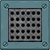
BACK030 | 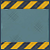
BACK031 | 
BACK040 | 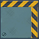
BACK041 | 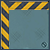
BACK042 | 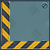
BACK043 | 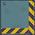
BACK050 | 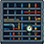
BACK060 | 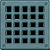
BACK070 | 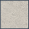
BACK080 | 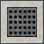
BACK090 | 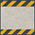
BACK091 | 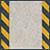
BACK100 | 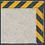
BACK101 | 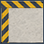
BACK102 | 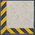
BACK103 | 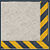
BACK110 | 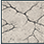
BACK120 | 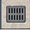


## Obstáculos

Var     | Image
--------| --------------------------------
OBST010 | 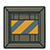
OBST020 | 
OBST030 | 
OBST040 | 
OBST050 | 
OBST060 | 
OBST070 | 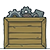
OBST080 | 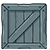
OBST090 | 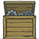
OBST100 | 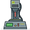
OBST110 | 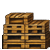
OBST120 | 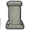
OBST130 | 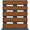
OBST140 | 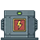
OBST150 | 
OBST160 | 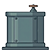
OBST170 | 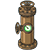
OBST180 | 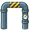
OBST190 | 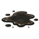
OBST200 | 
OBST210 | 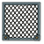
OBST220 | 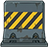
OBST230 | 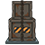
OBST240 | 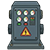
OBST25A | 


## Marcadores

Var     | Image
--------| --------------------------------
MARK010 | 
MARK02A | 
MARK02B | 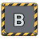
MARK02C | 
MARK030 | 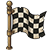